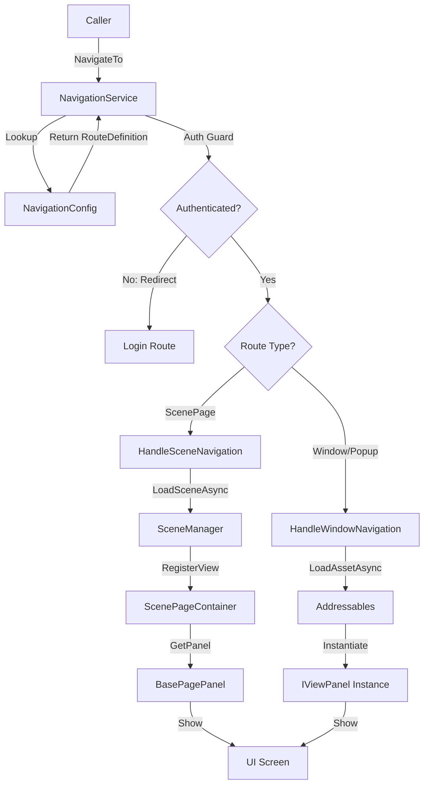

# Navigation System Technical Documentation

The **Navigation System** is a routing framework for Unity. It decouples UI logic from scene
management and provides one API for Scene-based Pages, Addressable Windows, and Popups.

## Key Features

- **Unified navigation** — navigate to Scenes or Addressables with a single method call.
- **Clean architecture** — Domain (interfaces), Infrastructure (logic), Core (UI bases).
- **Auth guards** — protect routes based on authentication state.
- **Payload support** — pass data between views during navigation.
- **History management** — back-stack with sub-panel history support.
- **Serialized navigation** — overlapping calls queue instead of interleaving.
- **Memory efficiency** — automatic release of Addressable assets.

---

## Architecture Overview

### 1. Domain (Interfaces)

`Runtime/Domain/Navigation`. Contracts only; nothing here depends on an implementation.

- `INavigationService` — main navigation API.
- `IViewPanel` — base contract for any view (Page, Window, or Popup).
- `IPagePanel` & `ISubPanel` — contracts for pages and their nested panels.
- `IPageContainer` — implemented by a scene root that owns local pages.
- `NavType`, `RouteFlags` — routing model.
- `Bridges/INavigationUIBridge` — UI layers and transition feedback.
- `Bridges/INavigationAuthBridge` — authentication state for guards.
- `Bridges/INavigationAudioBridge` — optional back-navigation sound hook.

### 2. Infrastructure (Implementation)

`Runtime/Infrastructure/Navigation`.

- `NavigationService` — the `INavigationService` implementation: routing, history, auth
  redirection, and Addressable management.
- `NavigationConfig` — ScriptableObject holding every `RouteDefinition`.
- `RouteDefinition` — a single destination; self-validating.
- `RouteState` — immutable history entry (route + environment + payload).

### 3. Core (Base Classes)

`Runtime/Core/Navigation`.

- `BasePagePanel` — base class for pages that live in a scene; owns sub-panel navigation.
- `BaseSubPanel` — base class for nested panels.
- `ScenePageContainer` — registers a scene's local pages with the service.
- `CanvasGroupFader` — fade helper with per-panel cancellation.

---

## Technical Flow



---

## Core Components

### `NavigationConfig`

The single source of truth for all routes.

| Property | Description |
| :--- | :--- |
| `LoginRouteId` | Destination for auth-guard redirects (default `"Login"`). |
| `DefaultRouteId` | Destination after sign-in when nothing was pending (default `"MainMenu"`). |
| `SceneRegisterTimeoutSeconds` | How long to wait for a loaded scene's `ScenePageContainer` (default 10). |
| `SceneTransitionDelaySeconds` | Settle delay after scene registration (default 2, 0 disables). |
| `Routes` | The list of `RouteDefinition`s. |

`Lookup` gives O(1) access; `TryGet(id, out def)` is the preferred API. Duplicate or empty
`RouteId`s are ignored with a warning.

### `RouteDefinition`

| Property | Description |
| :--- | :--- |
| `RouteId` | Unique identifier, e.g. `"Shop"`. |
| `Flags` | Behaviour flags (see below). |
| `Type` | `ScenePage`, `Window`, or `Popup`. |
| `TargetScene` | Scene name for `ScenePage` routes. |
| `Prefab` | Addressable reference for `Window`/`Popup` routes. |

### Route Flags

| Flag | Effect |
| :--- | :--- |
| `RequiresAuth` | Redirects signed-out users to `LoginRouteId`; resumes afterwards. |
| `IsAdditive` | Shown on top of the current route; GoBack closes it without re-navigating. |
| `IsTransient` | Never remembered in history. |
| `ClearHistory` | Clears the back-stack when navigated to (root route). |
| `BlockBack` | `GoBack` is ignored while this route is current. |

### `NavigationService`

Resolve via `INavigationService`.

**Main methods:**

- `NavigateTo(string routeId, string additionalNameScene = "", object payload = null)`
- `NavigateToInEnv(string routeId, string env, object payload = null)` — appends `_env` to the scene name.
- `GoBack()` — returns to the previous history entry.
- `HandleHardwareBack()` — sub-panels first, then route history; returns `false` when nothing is left.

**Threading guarantee:** navigation requests are serialized. A call made while a navigation is
in flight waits for it; a newer call supersedes the older one's loading work. All methods must
be called from the main thread.

---

## Guidelines for Use

### Setting up a new Scene Page

1. Create a UI panel that inherits from `BasePagePanel`.
2. Add a `ScenePageContainer` to the scene and map the `RouteId` to the panel.
3. Add a `RouteDefinition` of type `ScenePage` with `TargetScene` set to the scene name.
4. Make sure the scene's DI scope resolves the `ScenePageContainer` (VContainer).

The container registers itself with the service when the scene loads — no manual calls needed.

### Injecting payloads

```csharp
await _navigation.NavigateTo("UserProfile", payload: userData);
```

The target panel receives the payload in `SetPayload(object)`. If the payload is a `string` and
the page has sub-panels, that string is treated as the sub-panel id to open.

### Authentication guarding

Add `RequiresAuth` to the route. When an unauthenticated user navigates to it:

1. The intended route (with payload) is stored as a pending state.
2. The user is redirected to `LoginRouteId`.
3. When the auth bridge raises `OnAuthenticationChanged(true)`, the pending route is resumed.

---

## Advanced: Sub-Panel History

`BasePagePanel` supports nested navigation. If a profile page has "Edit" and "Settings"
sub-panels:

- `HandleHardwareBack` first pops the sub-panel history.
- Once the page is back at `defaultSubPanelId`, the next back press pops the route history.

> Always route in-game and hardware back presses through `HandleHardwareBack()` so the nested
> history is consumed before routes.

---

## Threading & Race-Safety Notes

- Navigation is serialized through an internal queue — no interleaving, no double windows.
- Scene registration can never be missed: the completion source is created before the load.
- Fades are per-panel and cancel the previous fade, so rapid Show/Hide can't race the alpha.
- `Dispose` unsubscribes the auth event and releases Addressable handles; safe to call once.
